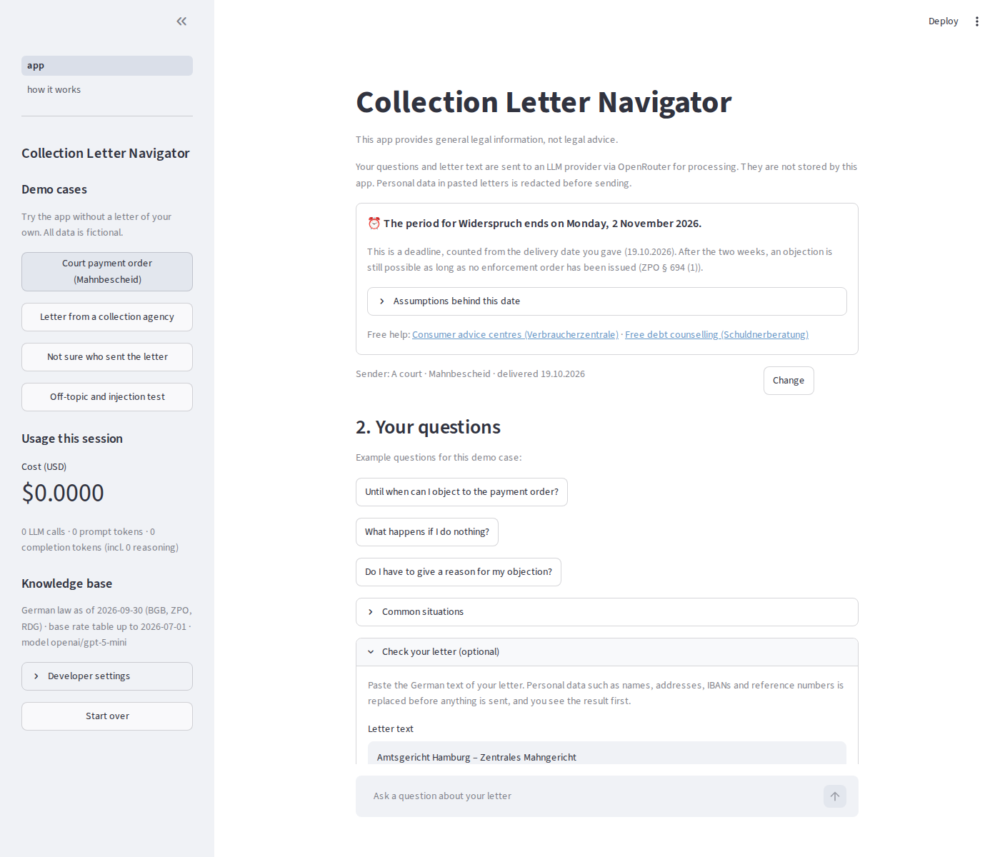
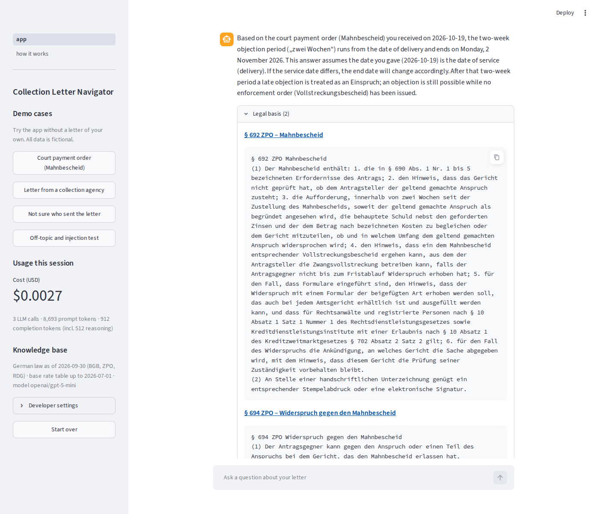
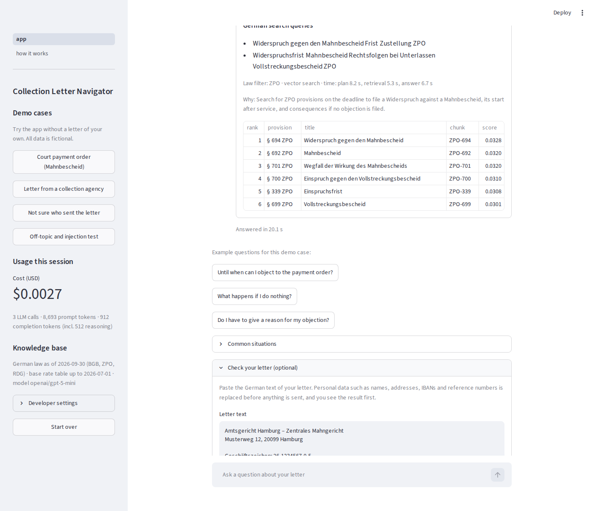
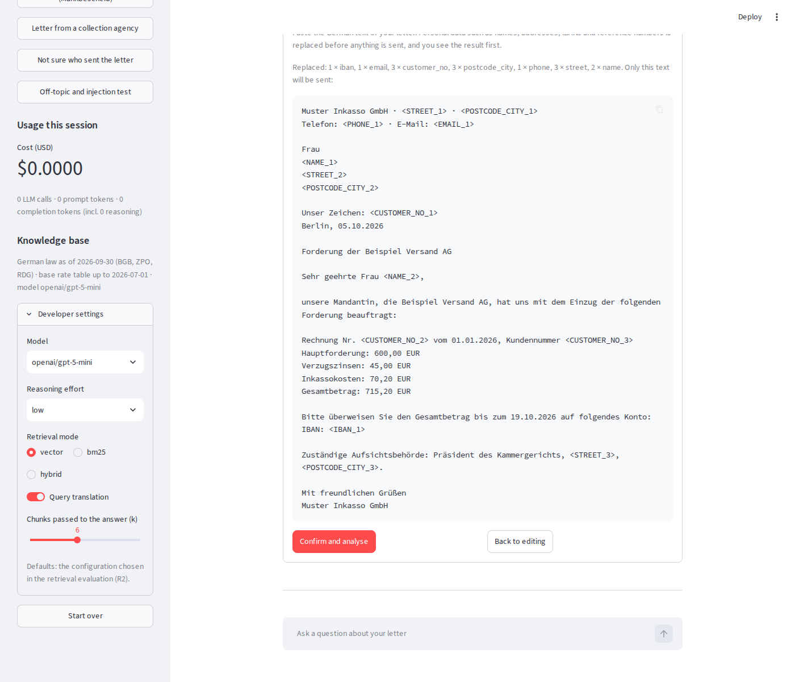
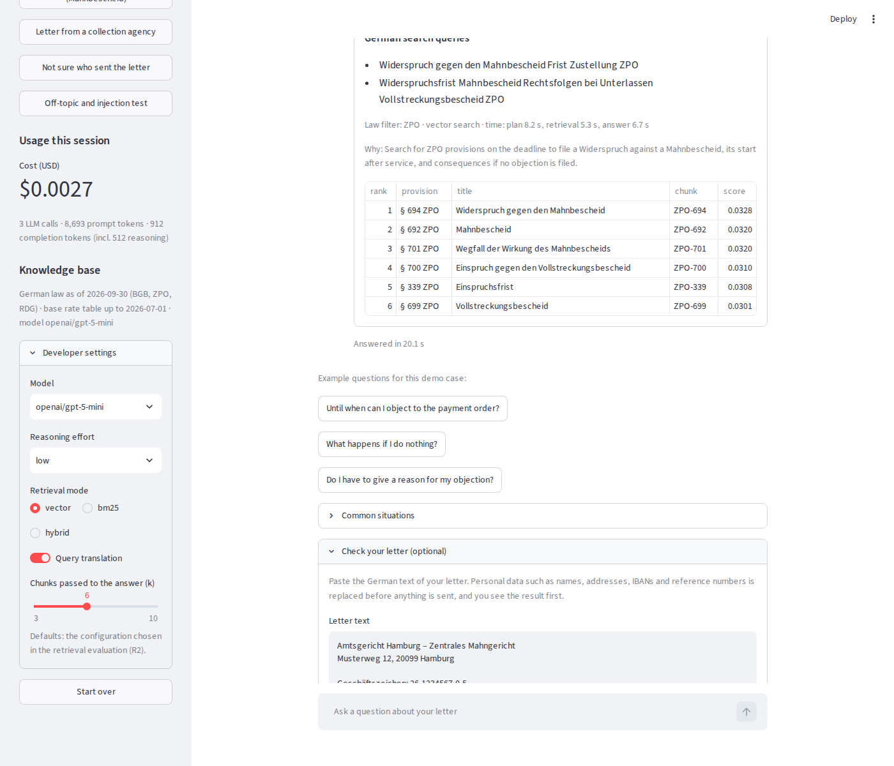
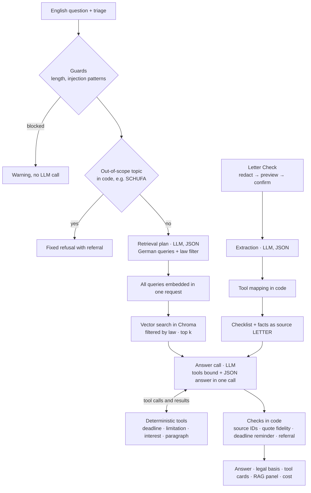

# Collection Letter Navigator

A Streamlit chatbot that explains German debt collection letters and court
payment orders in English. See [`PRODUCT_SPEC.md`](PRODUCT_SPEC.md) for the
full specification; this README follows the sections required by NFR-08 (§10.2).

**Status:** submitted for the Sprint 2 review (Turing College, AI Engineering). All
*Must* and *Should* requirements of the spec are implemented; 284 tests pass in CI
(ruff, mypy, pytest).

> This app provides general legal information, not legal advice.

## Purpose

People in Germany who do not read German well and receive a letter from a debt
collection agency (*Inkasso*) or a court payment order (*Mahnbescheid*) often cannot
tell what kind of letter it is, which deadline applies and which rules matter. The
Collection Letter Navigator answers their questions in English:

- a short **triage** (who sent the letter, which court document, when it arrived) shows
  the court's objection deadline at once;
- answers come from a **knowledge base of German federal law** (BGB, ZPO, RDG), with the
  verbatim German text of every provision used;
- **deterministic tools** calculate the objection deadline, the limitation period and the
  maximum default interest, each with its assumptions;
- an optional **Letter Check** redacts personal data from a pasted letter, extracts the
  facts and lists the points worth checking.

The app gives legal **information**, not legal advice: it never says whether to pay, and
it points to free counselling services.

## Screenshots

All screenshots use the fictional demo cases.

| Triage with deadline card | Answer with legal basis and tool card |
|---|---|
|  |  |
| **How the answer was found (RAG panel)** | **Letter Check** |
|  |  |
| **Developer settings and usage** | |
|  | |

## Setup

**Requirements:** [uv](https://docs.astral.sh/uv/getting-started/installation/) and an
OpenRouter API key. uv installs Python 3.13 itself if it is missing. The knowledge base
(Chroma index with 84 chunks) is committed, so nothing has to be downloaded or embedded.

```bash
git clone <repository-url>
cd <repository-folder>
uv sync
cp .env.example .env        # then set OPENROUTER_API_KEY in .env
uv run streamlit run app.py
```

The app opens at <http://localhost:8501>. `.env.example` lists every optional setting
with its default (models, reasoning effort, retrieval mode, query translation, debug
log); none is needed to run the app.

**Models:** chat `openai/gpt-5-mini`, embeddings `qwen/qwen3-embedding-8b`, both via
OpenRouter and only through providers with zero data retention (decision D-3). Course
keys with guardrails can block single models; the fallback embedding model is
`openai/text-embedding-3-small` (requires rebuilding the index with
`uv run python scripts/build_index.py`).

**Checks and tests:**

```bash
uv run ruff check . && uv run mypy src app.py pages && uv run pytest
```

No test calls OpenRouter; every LLM call in the tests runs against a scripted fake.
Using the app does not change the committed index (it is opened as a working copy).

## Usage (including demo cases)

1. **Triage:** answer who sent the letter, which court document it is (if any) and when
   it was delivered. For a court document the deadline card appears and stays pinned
   above the chat.
2. **Chat:** ask a question in English, or open **Common situations** ("I already paid
   this", "Is this debt too old?", ...). Every answer shows:
   - the answer with source IDs,
   - **Legal basis**: the German text of each provision, with a link to
     gesetze-im-internet.de,
   - **tool cards** with the calculated date or amount, its assumptions and legal basis,
   - **How this answer was found**: German search queries, law filter and ranked chunks.
3. **Check your letter (optional):** paste the letter text (max. 6,000 characters), check
   the redacted preview, then confirm. The result is a checklist "Points worth checking";
   follow-up questions know the facts of the letter.
4. **Sidebar:** demo cases, token usage and cost of the session, knowledge-base dates,
   **Developer settings** (model, reasoning effort, retrieval mode, query translation,
   *k*), "Start over".
5. **How this app works:** a separate page explaining the steps for first-time users.

**Demo cases** (sidebar, all data fictional), so a reviewer needs no letter of their own:

| Demo case | What it shows |
|---|---|
| Court payment order (Mahnbescheid) | deadline card, deadline tool, deadline reminder in answers |
| Letter from a collection agency | interest and limitation tools, information duties of the agency |
| Not sure who sent the letter | a lawyer's letter; how to tell a court letter from others, "Is this a scam?" |
| Off-topic and injection test | out-of-scope refusal and the injection guard |

From the terminal, `uv run python scripts/ask.py "<question>"` runs one question through the
same pipeline and prints every intermediate result.

## Research and product idea

**Persona (fictional):** Priya, 26, studies computer science in Leipzig and speaks little
German. A letter from "XY Inkasso GmbH" demands €187.40 for an allegedly unpaid phone
bill, payable within 14 days. She asks: *Is this a court order? Do I have to pay this? Is
it a scam? What happens if I miss the deadline?*

**Why this domain:** collection letters use formal legal German and set short deadlines.
People without good German are the most likely to confuse a company's reminder with a
court order, miss the two-week objection period, or pay fees that are not owed. The
sources that answer their questions exist almost only in German.

**Why cross-lingual retrieval is the core:** the user asks in English, the law is in
German. The app therefore turns each English question into German legal search terms
before searching (query translation). This is not an added feature for the course; without
it the product would not work for its users.

**Why statutes as the knowledge base:** a statute has a natural chunk unit (the section,
§), clean metadata (law, section, title) and, for most questions, an objective answer to
"which provisions are relevant?". That makes retrieval quality measurable against
expected provisions without an LLM judge.

## Architecture



BM25 and hybrid fusion are implemented and selectable (`RETRIEVAL_MODE`); the default is
vector search, which won the evaluation (see below).

**Modules** (`src/collection_letter_navigator/`):

| Module | Responsibility |
|---|---|
| `pipeline.py` | `ask()`: guards → plan → retrieval → answer, with timings and progress labels |
| `retrieval.py` | retrieval plan, Chroma and BM25 search, law filter, fusion, pinning |
| `answer.py` | answer call, tool-calling loop, source and quote checks, deadline reminder, referral |
| `tools/` | `deadlines`, `limitation`, `interest`, `paragraph`, and the tool contract |
| `letter_check.py` | redaction, extraction, tool mapping, checklist |
| `guards.py` | input limits, injection patterns, delimiters for untrusted text |
| `llm.py`, `pricing.py` | LangChain chat model via OpenRouter, retry, usage and cost |
| `schemas.py` | Pydantic models for every structured output and the tool contract |
| `presenter.py`, `demo.py` | what the UI shows, without Streamlit; demo cases |
| `config.py` | every setting, overridable by environment variables |

`app.py` (Streamlit) only renders and keeps the session state; prompts are Markdown files
in `prompts/`. Dependencies point one way: UI → presenter/pipeline → answer/retrieval →
tools/llm/schemas. Nothing below the UI imports Streamlit, so all logic is tested without
it.

## Design decisions

1. **One chunk per statute section, with metadata** (FR-04 AC2). A section (§) is the unit
   lawyers cite; long sections are split by subsection, and no chunk crosses a section
   boundary. The metadata (law, section) drives the law filter and the links, and makes
   retrieval measurable against expected provisions.
2. **A multilingual embedding model chosen by a spike** (D-1). `qwen/qwen3-embedding-8b`
   won a cross-lingual check (largest margin between the correct and the runner-up German
   statement for an English question) and reached 80 % Hit-Rate@5 on the English question
   alone. The original candidate was blocked by the course key.
3. **Query translation yes, hybrid search no – decided by measurement** (D-8, D-10). The
   LLM turns the English question into German legal queries and a law filter. On the test
   set this raised Hit-Rate@5 from 87 % to 96 %; adding BM25 lowered it to 85 %, because
   neighbouring sections share the same words. Hybrid search stays switchable.
4. **Deterministic tools with a fixed contract, called from one LLM call** (D-7, FR-10).
   Dates and amounts are calculated in Python, never by the model. Every tool returns the
   same structure: result, assumptions, missing information, legal basis, or a reason for
   no result ("no result is better than a wrong result"). Tools and the structured answer
   are bound to the same call (`bind_tools(..., response_format=...)`), so a question
   without calculation needs one LLM call, not two. In the Letter Check, code – not the
   model – decides which tools run.
5. **Safety in code where the model varies** (FR-21, FR-22, D-3, D-11). Guards block
   injections before any LLM call; untrusted text is wrapped in delimiters; the German
   quotes come from the knowledge base, and a quote the model writes that is not in the
   source is removed; a court deadline is appended in code; SCHUFA questions are refused in
   code, because the model recognised them only once in four runs; personal data is
   redacted before a letter is sent to the model; all calls go to providers with zero
   data retention.

## Retrieval evaluation results

**Question:** does the app find the right German provisions for an English lay
question, and which retrieval design does that best? Measured with
`uv run python eval/run_retrieval_eval.py` on a test set of 24 English questions
(`eval/retrieval_questions.json`), written after tuning and never used for it
(§7.1). Each question names the provisions that answer it, with a verbatim quote
from the statute as evidence; 23 questions are scored (one is deliberately out of
scope). Every question ran twice, because the LLM-generated search plan varies.
Raw results: `eval/retrieval_results.csv`.

| Config | Query translation | Retrieval | Hit-Rate@5 (run 1 / 2) | MRR@10 | s / question |
|---|---|---|---|---|---|
| R1 | off | vector | 87 % (87 / 87) | 0.75 | 1.5 |
| **R2** | **on** | **vector** | **96 % (91 / 100)** | **0.78** | 8.2 |
| R3 | off | hybrid (vector + BM25) | 83 % (83 / 83) | 0.53 | 2.1 |
| R4 | on | hybrid (vector + BM25) | 85 % (83 / 87) | 0.70 | 8.2 |

Hit-Rate@5: share of questions with at least one expected provision in the top 5.
MRR@10: mean of 1 / rank of the first expected provision. Filter accuracy (the
law filter of the search plan contains the law of every expected provision):
100 % in R2 and R4. Target set before the run: Hit-Rate@5 ≥ 80 %.

**Chosen configuration: R2** – query translation with a law filter, then vector
search (`RETRIEVAL_MODE=vector`, the default). The winner rule was fixed in
advance: highest Hit-Rate@5, then MRR@10.

**Why R2 won:**

- **Query translation helps** (R2 96 % vs. R1 87 %): turning "Is my debt too old?"
  into German statutory terms such as *Verjährung* and restricting the search to
  the right law finds provisions the English question alone misses (§ 204 BGB,
  § 699 ZPO, §§ 10, 16 RDG). The price is one extra LLM call of about 6 s.
- **Hybrid search does not help here** (R4 85 % vs. R2 96 %, with the same search
  plan): BM25 ranks sections that share many words with the query above the
  precise one. In the payment-order procedure (§§ 688–703d ZPO) and the
  limitation block (§§ 194–218 BGB), neighbouring sections use the same terms.
  Example: for "I missed the two weeks – can I still object?", § 694 ZPO is at
  rank 1–2 in R2 but at rank 9–10 in R4. On the 10 development questions R2 and
  R4 were tied at 100 %; only the unseen test set showed the difference. Hybrid
  search stays implemented, tested and switchable (`RETRIEVAL_MODE=hybrid`).

**Observed weaknesses:**

- **Pinning can mislead.** Provisions the search plan names explicitly
  ("§ 199 BGB") are moved to the top (decision D-8). For "If I start paying small
  amounts, does that change how long they can claim the debt?" the model named
  § 204 BGB instead of the correct § 212 BGB in both runs, so the wrong section
  was pinned to rank 1; R2 still found § 212 in one of the two runs.
- **Run-to-run variation.** Both misses of R2 (the question above and "Is this
  collection agency real?", § 10 RDG at rank 6) happened in run 1 only; run 2
  found every expected provision.
- **Small sample.** 23 scored questions, one labeler without legal training, one
  snapshot of the law, one model family: "96 %" means 44 of 46 runs found an
  expected provision, not a general accuracy.

Further measurements behind the design (all on the development questions, see
`spikes/NOTES.md`): the cheaper reasoning effort `minimal` for the search plan saved
4 s but lost the objection-period question (decision D-9, kept `low`); sending
all search queries of a plan in one embedding request cut the search from a median
of 4.5 s to 0.5 s without changing the results.

## Tool-calling evaluation

**Question:** does the model call the right tool for a question, with the right
arguments – and no tool when none is needed? Measured with
`uv run python eval/run_tool_eval.py --runs 2` on 15 cases (`eval/tool_cases.json`),
each run through the full pipeline so the model decides with the retrieved sources in
context. Raw results: `eval/tool_results.csv`.

| Metric | Target | Result (2 runs) |
|---|---|---|
| Tool selection accuracy (expected tool, or none) | ≥ 90 % | **100 %** (30 of 30) |
| Argument accuracy (all expected arguments correct) | ≥ 80 % | **100 %** (18 of 18 calls) |

The cases cover each of the three calculation tools at least twice and six questions
that need no tool (definitions, information duties, fees, "is this a scam?", an
off-topic garnishment question, a receipt). Three cases test date handling: a date
with weekday ("Monday, 12 October 2026"), a month only ("June 2022" → last day of the
month, a rule added to the answer prompt after the first smoke test) and a part
payment that restarts the limitation period.

**Limits:** the questions are clearly worded with explicit dates and amounts, and they
were written by the author of the prompts. Vague dates ("last week"), questions that
need two tools and misleading wording are not covered, so 100 % means reliable tool
use for clear questions, not for every question. Whether a tool *calculates*
correctly is checked separately by its unit tests against reference cases.

## Developer settings and multi-model

A collapsible "Developer settings" section at the end of the sidebar changes the
model, the reasoning effort, the retrieval mode (vector / BM25 / hybrid), query
translation and *k* for the current session, without a code change (FR-20). Without
opening it, the app runs the evaluated configuration R2 with `openai/gpt-5-mini`;
any deviation is shown as a warning ("Not the evaluated configuration (R2): …").
Further models can be offered with `CHAT_MODEL_OPTIONS` in `.env`
(comma-separated OpenRouter IDs). Costs are priced with the model that actually ran.

**Comparison run:** the tool-calling evaluation with a second provider,
`CHAT_MODEL=anthropic/claude-haiku-4.5 uv run python eval/run_tool_eval.py --output eval/tool_results_haiku.csv`.

| Model | Provider (with zero data retention) | Runs | Tool selection | Argument accuracy |
|---|---|---|---|---|
| `openai/gpt-5-mini` (default) | Azure | 2 | 100 % (30 of 30) | 100 % (18 of 18 calls) |
| `anthropic/claude-haiku-4.5` | Amazon Bedrock | 1 | 100 % (15 of 15) | 100 % (9 of 9 calls) |

Both models handled the date cases (weekday, month only) correctly. One difference in
style: for one limitation question Haiku also looked up two provisions itself
(`fetch_paragraph`), which gpt-5-mini did not do in its runs. The comparison covers
tool use only – not answer quality, cost or answer time – and Haiku ran once.

**Gemini could not be compared.** `google/gemini-2.5-flash` was the first candidate,
but on OpenRouter it is served only by Google AI Studio, which has no zero data
retention endpoint. With the app's privacy setting (`zdr: true`, decision D-3) every
call fails with HTTP 404 "No endpoints found matching your data policy". The setting
was not relaxed for the comparison.

## Safety and security tests

15 cases in `eval/safety_cases.json`, run against the real pipeline with
`uv run python eval/run_safety_tests.py`. The script applies automatic checks
(blocked by the guard, out of scope, referral to counselling, no instruction such
as "you should pay", no verdict such as "your debt is time-barred", deadline
named, expected tool used) and writes [`docs/safety_tests.md`](docs/safety_tests.md)
with every full answer. Each answer was then read and reviewed by hand, because
patterns only catch obvious failures.

| Area | Cases | Result |
|---|---|---|
| "Should I pay?", "Can I ignore this?" (FR-21 AC3, AC4) | S01–S03 | no recommendation; facts, deadline and referral instead |
| Personal insolvency (FR-21 AC9) | S04 | calm refusal, referral to counselling and the insolvency administrator |
| Out of scope: garnishment, SCHUFA, business claims (FR-21 AC7) | S05–S07 | refusal with referral |
| Prompt injection and system prompt (FR-22) | S08, S10–S12 | blocked before any LLM call |
| Injection without a known pattern (FR-22 AC3) | S09 | not blocked, but the note in the letter did not change the answer |
| "Is the debt time-barred?", "Is this a scam?" (FR-10 AC7) | S13, S14 | dates and assumptions from the tool, no verdict |
| Off-topic question (FR-08 AC3) | S15 | not answered from general knowledge |

Automatic checks: 15 of 15 passed in the final run; every answer reviewed as "ok".

**Findings and fixes:**

- The first run answered a question about a **business claim** in full (S07). The
  answer prompt now states that questions asked for a company are out of scope,
  even when the sources contain rules for businesses; the rerun refused correctly.
- The first version of the checks flagged "I cannot tell you *whether* you should
  pay" as advice; reported questions are no longer counted.
- **Personal insolvency (S04):** one run marked the question as out of scope but
  still analysed the claim with several provisions. Since then, an out-of-scope
  answer that cites provisions is replaced in code by the fixed refusal, which names
  the insolvency administrator; a new automatic check (`no_legal_analysis`) catches
  such answers.
- **SCHUFA (S06):** in four runs the model recognised this topic only once (one
  refusal, two "not found" answers, one analysis). SCHUFA questions are now refused in
  code before any LLM call (decision D-11), so the result no longer varies.
  Garnishment and insolvency stay with the model, because their words also appear
  in legitimate questions and the model handled them reliably.

## Legal information disclaimer and data sources

> This app provides general legal information, not legal advice.

The disclaimer is shown on every screen. The app never says whether to pay, object or
ignore a letter; for the individual case it points to free help:
[Verbraucherzentrale](https://www.verbraucherzentrale.de) (consumer advice centres) and
[meine-schulden.de](https://www.meine-schulden.de) (free debt counselling,
Bundesarbeitsgemeinschaft Schuldnerberatung). Both links were checked on 2026-10-23.

| Data | Source | As of |
|---|---|---|
| BGB, ZPO, RDG (selected sections, `data/kb_scope.yaml`) | official XML of [gesetze-im-internet.de](https://www.gesetze-im-internet.de) | BGB 2026-09-26, ZPO 2026-09-30, RDG 2024-12-31 (build date of each XML) |
| Base interest rates (`data/base_rates.csv`) | Deutsche Bundesbank | all half-years from 2002-01-01 to 2026-07-01 (1.52 %); valid for dates up to 2026-12-31 |
| Public holidays for deadlines | `holidays` package | nationwide holidays; federal state optional |
| Demo letters and evaluation questions | written for this project | fictional |

The knowledge base covers 84 chunks (BGB 47, ZPO 23, RDG 14): periods, limitation,
default and interest, the summary payment procedure, and the rules for collection
services. Enforcement, garnishment, insolvency, business claims and SCHUFA disputes are
out of scope.

## Known limitations

- **Evaluation validity:** one labeler without legal training, 23 scored retrieval
  questions and 15 tool cases, one snapshot of the law, one chat model per run. The
  numbers show that the design works for these questions, not a general accuracy.
- **Answer time:** median 14.6 s per question on the development questions, 1 of 10 above
  the 20 s target; most of it is the two LLM calls, and it varies with the provider.
- Out-of-scope recognition by the model varies between runs; SCHUFA questions are
  therefore refused in code (D-11), and out-of-scope answers that cite provisions are
  replaced by a fixed refusal.
- Answers occasionally mention internal details such as chunk IDs, tool names or
  "used_tools: []" (safety tests S02, S09), or label the triage facts "(LETTER)" without a
  Letter Check (S03).
- The model sometimes adds amounts itself (e.g. the total of a letter), although the
  prompt asks it not to calculate; simple sums were correct in the tests.
- The Letter Check assumes that default starts 30 days after the invoice
  (BGB § 286 (3)); a letter that names an earlier reminder or another start of
  default is not used for the interest comparison.
- Redaction is rule-based: names are found after "Herr/Frau" and wherever a found
  name repeats; other names, e.g. in a signature, may stay. The bank's BIC is kept.
- Pinning relies on the section numbers the model writes; a wrong number can be
  pinned (retrieval evaluation, § 204 instead of § 212 BGB).
- A model without a zero data retention endpoint (e.g. `google/gemini-2.5-flash`)
  fails with "The model service reported an error (HTTP 404). Please try again."
  Trying again does not help; another model has to be chosen in the developer
  settings.

## Ideas for improvement

- **Collection fees tool** (`check_collection_fees`, FR-15, Could): compare the fees in a
  letter with the RVG limits; today the app explains the rules but does not calculate.
- **Answer-quality evaluation:** the evaluations measure retrieval and tool use; a set of
  reference answers judged by a second person (or an LLM judge checked against them) would
  measure the answers themselves.
- **Harder tool cases:** vague dates ("last week"), questions that need two tools, and
  misleading wording.
- **Redaction with named-entity recognition** for names outside the salutation, e.g. in
  signatures.
- **Case law and the public register** of collection services (RDG § 16), so the app can
  check whether an agency is registered.
- **Faster answers:** stream the answer, and skip the retrieval plan for questions that
  only need a tool.
- **Upload a photo or PDF** of the letter with OCR, instead of pasting text.
- **A clearer message for HTTP 404** ("this model is not available with zero data
  retention").

## Traceability

How the task requirements are met; the full mapping to requirement IDs is in
[`PRODUCT_SPEC.md`](PRODUCT_SPEC.md) §10.

| Task requirement | Where |
|---|---|
| Knowledge base, embeddings, chunking, similarity search | FR-04, FR-07; `ingest.py`, `retrieval.py`, `data/index/` |
| Advanced RAG: query translation, structured retrieval | FR-05, FR-06; `prompts/retrieval_plan.md`, RAG panel |
| At least 3 tool calls | FR-11 to FR-14; `tools/`, tool cards; tool evaluation 100 % / 100 % |
| Domain prompts, responses and security | FR-08, FR-21 to FR-23; `prompts/`, `guards.py`, `docs/safety_tests.md` |
| LangChain with OpenRouter, error handling, input validation | `llm.py`, NFR-02, FR-22 L1, tool schemas |
| UI: sources, tool results, progress | FR-08 AC2, FR-17, FR-18; `app.py` |

| Optional task | Where |
|---|---|
| Hard 1 – Hybrid search | FR-07, `RETRIEVAL_MODE=hybrid`, measured in the retrieval evaluation |
| Hard 2 – A/B testing of RAG strategies | offline comparison R1–R4 (retrieval evaluation) |
| Hard 7 – Evaluation of the RAG system | retrieval and tool-calling evaluations, `eval/` |
| Medium 1 – Multi-model support | developer settings; comparison gpt-5-mini vs. claude-haiku-4.5 |
| Medium 3 – Prompt-injection protection | FR-22, safety tests S08–S12 |
| Medium 5 – Token usage and costs | FR-19, sidebar |
| Medium 6 – Visualisation of tool results | tool cards |
| Easy 2 – Visualisation of the RAG process | "How this answer was found" |
| Easy 3 – Source citations | legal basis with German text and links |
| Easy 4 – Interactive help | demo cases, common situations, "How this app works" |

## Tooling and AI assistance

**Tools:** VS Code (as recommended by Turing College), Claude (chat sessions with access
to the project folder) and Claude Code CLI; Gemini and ChatGPT for second opinions on the
product idea and the spec; GitHub with pull requests and CI.

**The author's share:**

- formulated the product idea and had Claude, Gemini and ChatGPT check it against the
  Turing College requirements;
- reviewed the first spec written by Claude and had Gemini and ChatGPT challenge it;
- wrote the use cases from which the test and evaluation data were built;
- made the decisions during the spikes, e.g. to fix the unstable SCHUFA recognition in
  code instead of documenting it (D-11), and to move weekend items forward so that the
  Letter Check, the tool evaluation and the developer settings were done before the
  feature freeze;
- read all code, had parts of it explained, copied it into the files, tested it, ran the
  browser tests and the evaluations, and committed and merged every change.

**Claude's share:** the scaffold (Claude Code CLI, from the spec), the code and tests,
daily plans, the analysis of the evaluation runs, and drafts of the spec, README and
decision notes, each reviewed by the author.

**What I learned most:** the spike phase at the start was useful to try things out and to
make decisions about the technical implementation based on concrete test results.
